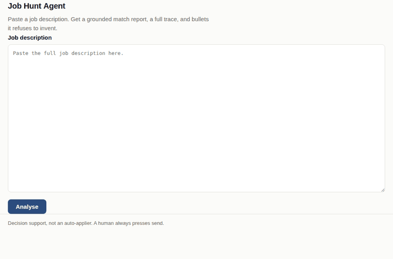

# Job Hunt Agent

An LLM agent that reads a job description, scores you against it using evidence
retrieved from your own resume and project write-ups, and drafts tailored resume
bullets — refusing to draft any bullet it cannot ground in a document you
actually wrote.

**Live URL:** _not deployed yet — run `./deploy.sh` and paste the URL here (see [DEPLOY.md](DEPLOY.md))._



It is decision support, not an auto-applier. It does not submit anything
anywhere. A human always presses send.

More samples, including the result page as a standalone file, are in
[`samples/`](samples/). The audit that preceded the last build pass is in
[AUDIT.md](AUDIT.md).

---

## Architecture

```
  Chrome extension ──┐                (reads the posting on the tab you have open;
  (activeTab only)   │                 no scraping, no auto-fill, no auto-submit)
                     ▼
                     ┌───────────────────────────────────────────┐
  browser ── POST ──▶│ FastAPI  ( / , /analyse, /api/analyse,    │
                     │           /health, /metrics )             │
                     │  middleware mints request_id ─────────────┼──▶ JSON logs
                     └──────────────────┬────────────────────────┘   (one line
                                        │                             per event)
                                agent/loop.run()
                                        │
  ┌─────────────────────────────────────┼──────────────────────────────────────┐
  │ bounded loop — at most MAX_STEPS iterations                                │
  │                                     ▼                                      │
  │                      ┌───────────────────────────┐                         │
  │                      │  planner.next_action()    │──── Claude ────────────▶│
  │                      │  goal + state + the four  │  chooses ONE action     │
  │                      │  tool schemas + trace     │◀────────────────────────│
  │                      └─────────────┬─────────────┘                         │
  │                                    │ a tool call, or finish                │
  │                                    ▼                                       │
  │   ┌────────────────────────────────────────────────────────────────────┐   │
  │   │ parse_requirements (Claude)     retrieve_evidence (BM25, no model) │   │
  │   │ score_match        (Claude)     draft_bullets     (Claude)         │   │
  │   └────────────────────────────────┬───────────────────────────────────┘   │
  │                                    │  after draft_bullets, always          │
  │                                    ▼                                       │
  │                        guardrail.enforce()   ← grounding check, in code    │
  │                                    │                                       │
  │                          append Step ──▶ trace  (successes AND failures)   │
  └────────────────────────────────────────────────────────────────────────────┘
                                        │
                    AgentResult ──▶ result.html + sqlite (runs table)
```

`retrieve_evidence` reads a BM25 index built at startup from
`app/corpus/documents/*.md` — your resume and project write-ups, chunked at the
markdown section level, so a citation reads `resume#databases` and points at a
paragraph rather than a whole document.

---

## How the agent loop works

**A planner decides every step.** `planner.next_action(goal, tool_schemas,
trace_so_far)` is one Claude call given the goal, the current run state, the
four tools as real tool definitions, and a compact rendering of everything that
has happened so far. It returns one tool call or `finish`. The order is not
hard-coded anywhere — script the planner to retrieve before parsing and the loop
does exactly that, and there is a test asserting it.

Each planner-facing tool schema carries a required `why`. The dispatcher strips
it before calling the tool and puts it in the trace, which is where the "why
chosen" column comes from. The tools themselves take no rationale argument.

**The loop is bounded.** It terminates on `finish` or at `MAX_STEPS`, whichever
comes first, and records which in `terminated_reason`.

**Error policy is per call**, and it is three separate things that are easy to
conflate:

| Failure | Response |
|---|---|
| Call exceeds `TOOL_TIMEOUT_S` | Abandon it, classify `upstream_timeout`, treat as retryable |
| HTTP 429 or 5xx | Up to two retries, exponential backoff (0.5s, 1.0s) |
| Any other 4xx | Not retried — it is a bug in our request, and retrying reproduces it |
| Model output fails schema validation | Feed the validator's own message back **once**; on a second failure record a failed step and let the planner decide |

The status code is authoritative when the SDK gives one, so a class named
`RateLimitError` carrying a 400 is still not retried.

**The trace is an output, not a log.** Every step — including every failure —
becomes a `Step` with its tool, arguments, rationale, latency, token counts and
error kind. It is rendered on the result page, persisted with the run, and
asserted on in tests. `total_latency_ms` is the sum of the step latencies, so
the total reconciles with the rows above it.

**Two clients, one interface.** `LLM_CLIENT` selects between `anthropic` (real
API) and `scripted` (canned replies over live retrieval). The test suite runs
entirely against the scripted client, offline, in under two seconds. Scripted
mode is also a supported runtime: the deployed app answers with no API key and
at zero cost, and the result page carries a banner saying the model output is
canned. Everything else on that page — retrieval, the validator, the trace, the
metrics, the stored run — is real.

### Where the model is constrained, and why

This is the part worth reading closely.

1. **Every model call is forced into a typed schema.** Each tool is a real
   Anthropic tool definition generated from the Pydantic model it returns, with
   `tool_choice` pinned to it. The model does not emit JSON in prose that we then
   hope to parse; it fills in a tool call, and Pydantic validates at the
   boundary.

2. **The model may not author an `Evidence` object.** When scoring, it receives
   the retrieved passages with their ids and may return only *ids it was given*.
   The server rehydrates the snippet, the score and the relevance from what
   retrieval actually returned. A model that cannot construct an evidence object
   cannot construct a convincing fake one.

3. **The model may not report a number.** `hard_met` and `hard_total` are
   computed from the verdicts; the scoring schema has no field for a total, so
   there is nowhere to put an unexplained one. A verdict of `met` or `partial`
   citing nothing retrieval returned is rewritten to `gap`, whatever the model
   called it.

4. **The model may not attest to its own refusals.** `refusal_source` is not in
   the schema the drafting model fills in. A refusal arriving in that response is
   stamped `model`; the validator stamps `validator` on its own overrides. The
   page shows the difference, because "the model declined" and "the model wrote a
   claim and the code threw it out" are very different facts about a candidate.

5. **Bullets are validated after the fact, in code.** `guardrail.enforce` runs
   after `draft_bullets` and before anything reaches the user. Every non-refused
   suggestion must cite at least one `doc_id`, and every id it cites must appear
   in the evidence retrieved *for that requirement* — not merely somewhere in the
   corpus, and not under a different requirement. Anything failing either check
   becomes a refusal, and the discarded draft is logged but never displayed.

   The prompt also asks the model to behave. Both layers exist deliberately: the
   prompt is how you get good behaviour most of the time, the validator is how
   you get a guarantee. A prompt cannot be tested, only sampled.
   `tests/test_guardrail.py::test_fabricated_citation_becomes_a_refusal` proves
   the validator catches a fabricated citation.

**Refusals are shown, not hidden.** They are the most informative thing on the
page: a refusal says the corpus contains no evidence for a requirement, which is
both the honest answer and the one that survives an interview.

---

## Design decisions and tradeoffs

Full list in [DECISIONS.md](DECISIONS.md). The ones that shaped the system:

**The grounding validator is code, not a prompt.** See constraint 5 above. This
is the core of the product: everything else is a way of getting good input to it.

**Extraction is client-side, in a Chrome extension.** Reading the posting in
your browser is not a workaround, it is the correct design. Server-side scraping
of LinkedIn, Indeed and company career sites is fragile (markup changes weekly),
rate-limited, IP-blocked, frequently against the site's terms, and blind to
postings behind a login you are already authenticated for. Your browser is
already authorised to read the page in front of you. The server never talks to
the job board at all. See [`extension/`](extension/).

**BM25 over a vector database.** The corpus is one resume and a few project
write-ups — a few dozen chunks. `rank_bm25` runs in-process, needs no service,
returns exact and explainable scores, and rebuilds at startup in milliseconds.
An embedding store would add infrastructure, a network hop and an opaque
similarity number to a corpus small enough to read end to end. The cost is
paraphrase, and it is a real cost — see Known limitations.

**Section-level chunks.** A citation reading `resume#databases` points at a
paragraph a reviewer can check. One reading `resume` points at a resume.

**Retrieval returns everything it found, and marks what is weak.** Passages
below the relevance threshold are flagged, not dropped. Dropping them is what
made the report say "no evidence retrieved" for a requirement whose trace showed
three passages one step earlier. The verdict now carries every retrieved
passage, each marked `relevant` and `cited`, and the page renders three distinct
states: nothing retrieved · retrieved but all below threshold · the relevant
passages.

**SQLite, not Postgres.** One writer, one process, a handful of rows per run,
and the data is run history rather than anything a decision depends on. Postgres
would add a service to operate and a connection pool to tune in exchange for
nothing this workload needs. The cost is named under deployment caveats in
DEPLOY.md: on Container Apps the file is ephemeral.

**One provider, called directly.** No abstraction layer over LLM providers.
There is one provider; a second is a refactor, not a design constraint, and
premature indirection buys only a layer to read through. `LLM_CLIENT` selects
between the real client and a scripted one — that is a test seam and a demo
mode, not a provider abstraction.

**A missing API key degrades `/health` rather than crashing the process.** A
container that boots and reports `anthropic_api_key: fail` is easier to diagnose
than one that crash-loops before it can answer a probe. In scripted mode the key
is not a dependency at all, and `/health` says so.

**Metrics are in-process counters, not Prometheus.** Single process, no external
infrastructure, JSON at `/metrics`. The latency window is bounded at 500 runs so
it answers "how is it behaving now" — the question you ask during an incident.

---

## Known limitations

These are real, and the project would be worse if it claimed otherwise.

- **BM25 fails on paraphrase.** Lexical matching is the central weakness. A
  requirement for "container orchestration" will not retrieve a section that says
  "Kubernetes", because they share no tokens. The system then reports a gap and
  refuses to draft — a *false* refusal, indistinguishable from a true one. This
  is the highest-value thing to fix, and the fix is a hybrid retriever: BM25 for
  exact technical tokens plus embeddings for paraphrase, merged by reciprocal
  rank fusion.

- **There is no rerank.** Retrieval is a single BM25 pass; the top-k it returns
  is the top-k that gets scored. A cross-encoder rerank over the top ~20 would
  materially improve precision at k=3, which is exactly where this system lives,
  and it is the natural second step after hybrid retrieval. Not built.

- **Relevance is relative, so 100% does not mean "strong".** `score_normalized`
  is the passage's BM25 score divided by the best score *for that same query*,
  because raw BM25 is unbounded and incomparable across queries. The consequence
  is that the top hit is always 100%, even when it is a poor match in absolute
  terms. The percentage answers "how close to the best available evidence", not
  "how good is this evidence". Calibrating an absolute scale needs the labelled
  set this project does not have.

- **Long job descriptions degrade quietly.** The whole JD goes into
  `parse_requirements` in one call, and a truncated preview goes to the planner
  on every step. A very long posting inflates cost per step and can pull
  requirement extraction toward whichever parts of the text the model weights
  most. There is no chunked-parse path and no explicit length guard.

- **Cost and latency scale with requirement count.** A run is roughly
  `3 + n_requirements` model calls: one planner call per step, plus one each for
  parsing, scoring and drafting. Retrieval itself is free, but each retrieval
  still costs a planner call to decide on. A twelve-requirement posting is
  comfortably fifteen-plus calls, and `MAX_STEPS=12` means such a posting can hit
  the ceiling before scoring — reported honestly as
  `terminated_reason: max_steps`, but still a truncated answer.

- **The guardrail checks grounding, not truthfulness.** It guarantees a bullet
  cites a document retrieval actually returned for that requirement. It cannot
  tell whether the bullet *fairly characterises* what that document says. A model
  that cites a real passage and overstates it will pass. Read the bullets.

- **Corpus quality is the ceiling.** Garbage in, honest refusals out.

- **Abandoned timeout threads.** A call exceeding `TOOL_TIMEOUT_S` is abandoned
  rather than cancelled — Python cannot interrupt an arbitrary blocking call.
  Under sustained upstream slowness this leaks threads for the length of the
  SDK's own timeout.

- **Single process, single node.** SQLite, in-memory metrics, in-process index.
  A second replica breaks all three. Deliberate for a portfolio project, not a
  design that survives scaling.

- **No evaluation set.** There is no labelled corpus of job descriptions with
  known-correct verdicts, so prompt changes are validated by reading output, not
  by a score. That is the honest state of it.

---

## Observability

**Structured logs.** One JSON object per line, one line per event. The request
id lives in a `ContextVar`, set by middleware and injected by the log formatter —
so "every line carries a `request_id`" is true by construction, not by
discipline. It survives the hop into the loop's worker threads because
`_with_timeout` submits through `copy_context()`, and it is echoed as
`x-request-id`, so a user-reported problem maps to its log lines.

```json
{"ts":"2026-08-30T12:00:16Z","level":"info","logger":"jobhunt","request_id":"8b3ab3a225d8","event":"step_ok","step":2,"tool":"retrieve_evidence","latency_ms":143,"tokens":240,"summary":"3 passages, 2 above threshold, top resume#databases"}
```

**`GET /health`** reports each dependency separately and returns 503 unless all
are ok. SQLite round-trips a real query; the corpus reports its document and
chunk counts **and fails if any document still contains the literal string
`TODO: replace`**, because a corpus of placeholders indexes and retrieves
fluently while answering nothing; the API key is checked only when
`LLM_CLIENT=anthropic`.

```json
{"status":"ok","model":"claude-sonnet-4-5","llm_client":"anthropic","checks":{
  "sqlite":{"status":"ok","detail":"ok","path":"/data/runs.db"},
  "corpus":{"status":"ok","detail":"ok","documents":3,"chunks":14,"placeholder_documents":[]},
  "anthropic_api_key":{"status":"ok","detail":"present"}}}
```

**`GET /metrics`** returns run count by termination reason, per-tool call and
failure counts, p50/p95/max run latency over a bounded window, input/output token
totals, guardrail rejections, and error counts for every member of the taxonomy.

**Error taxonomy.** Every failure maps to exactly one `ErrorKind`:
`upstream_timeout`, `upstream_rate_limit`, `schema_validation`,
`tool_execution`, `max_steps_exceeded`, `corpus_empty`. Steps carry the kind in
`Step.error`; metrics count by it. "What is breaking" is answerable without
grepping log text.

**Alert condition.** Page when **either** holds:

- `metrics.latency_ms.p95 > 30000` (p95 run latency above 30s), **or**
- `metrics.alerts.max_steps_rate_last_20 > 0.10` (more than 10% of the last 20
  runs terminated at `max_steps`).

The first catches upstream slowness and retry storms. The second catches the
failure mode that does not look like an error at all: the planner looping without
converging, which returns a plausible-looking page with a truncated report. Both
values are served by `/metrics` under `alerts` alongside their thresholds, so the
alert rule is a comparison rather than a computation.

---

## Local setup

```bash
pip install -r requirements-dev.txt
export ANTHROPIC_API_KEY=sk-ant-...      # or: export LLM_CLIENT=scripted, and no key at all
uvicorn app.main:app --reload            # http://127.0.0.1:8000
```

**Fill in the corpus first.** `app/corpus/documents/` ships three placeholder
files — `resume.md` and two `project-*.md` — whose bodies are marked
`TODO: replace`. Replace them with your real resume and project write-ups,
keeping the front-matter `id` and the `## ` headings; each heading becomes one
separately citable chunk. `/health` reports the corpus as failed until you do,
on purpose.

| Variable | Default | Meaning |
|---|---|---|
| `ANTHROPIC_API_KEY` | — | Required when `LLM_CLIENT=anthropic` |
| `LLM_CLIENT` | `anthropic` | `anthropic` or `scripted` |
| `MODEL` | `claude-sonnet-4-5` | Model id |
| `MAX_STEPS` | `12` | Planner iterations before termination |
| `TOOL_TIMEOUT_S` | `30` | Wall-clock bound per tool call |
| `DB_PATH` | `runs.db` | SQLite file |
| `CORPUS_DIR` | `app/corpus/documents` | Corpus location |
| `LOG_LEVEL` | `INFO` | Log level |

```bash
pytest                            # offline, ~2s; the one live-API test skips without a key
ruff check app tests scripts
python scripts/smoke_live.py      # one real API run; needs ANTHROPIC_API_KEY
python scripts/render_sample.py   # regenerate samples/scripted-run.html
python scripts/record_demo.py     # regenerate samples/demo.gif (needs playwright + pillow)
docker build -t job-hunt-agent . && docker run -p 8000:8000 -e LLM_CLIENT=scripted job-hunt-agent
./deploy.sh                       # Azure Container Apps — see DEPLOY.md
```

CI runs lint and the offline suite on every push, then builds the image and
asserts the container answers `/health` with per-dependency status. The one
live-API test skips itself when no key is present, so CI is deterministic and
free.
